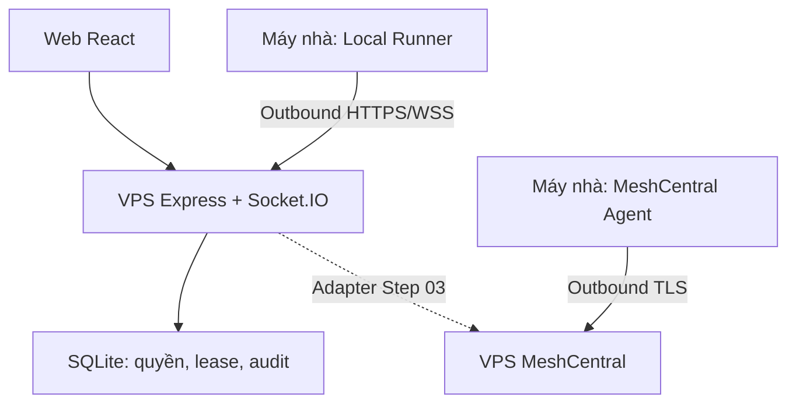

# Kiến trúc và luồng

Traefik đứng trước Express và MeshCentral, hai domain HTTPS riêng. SQLite không public. MeshCentral data không dùng chung file DB của Express. Không truyền credential MeshCentral admin xuống FE.

## Presence
Socket xác thực → agent ready → heartbeat mỗi 5s → backend cập nhật seen → snapshot gửi cho các browser có quyền mỗi 2s. Local Runner lấy CPU, RAM và bộ đếm byte mạng; mặc định gửi `agent:status` mỗi 10 giây (cấu hình 5–60 giây). Backend kiểm tra schema và giới hạn tần suất, giữ status trong bộ nhớ rồi đưa vào snapshot theo cùng bộ lọc membership. Status không được ghi SQLite; nó bị xóa khi runner offline hoặc backend khởi động lại. Quá 25s không có heartbeat backend disconnect và revoke lease. Mất kết nối được đánh offline ngay khi phát hiện. Một credential chỉ có một socket agent active. Agent thứ hai bị từ chối, không thay socket đang sống.

Status mạng là tốc độ byte nhận/gửi. Linux cộng các adapter trong `/proc/net/dev` trừ `lo`; Windows cộng các adapter do `Get-NetAdapterStatistics` trả về qua lệnh PowerShell cố định trong Local Runner. Adapter ảo/VPN có thể được tính vào. Khi runner offline hoặc chưa có mẫu đầu tiên, UI để số liệu là chưa có thay vì suy đoán.

## Script allowlist
Runner nạp manifest local từ `SCRIPTS_PATH` (mặc định `./data/scripts.json`). Manifest giữ executable, args cố định, cwd và schema params; catalog gửi lên VPS chỉ có id/label/params options. Browser chọn scriptId và params; backend xác thực membership, active lease và schema rồi gửi job tới runner đã xác thực. Runner kiểm tra lại và gọi `spawn(executable,args,{cwd,shell:false})`. stdout/stderr được stream theo jobId, giới hạn một tiến trình/thiết bị và 64KiB output/job. Stop, lease revoke/takeover, timeout và disconnect dừng process theo platform. File params chọn option ID, runner map sang path trong cwd đã cấu hình; browser không gửi path.
VPS mất kết nối browser: FE xóa snapshot và hiển thị chưa kết nối; kết nối lại nhận snapshot mới. Browser không thể biết VPS mất điện hay mạng client bị lỗi chỉ từ disconnect. Runner online nghĩa là tiến trình runner liên lạc được, không bảo đảm desktop interactive đang sẵn sàng.

## Lease / handshake
1. Browser socket đã auth yêu cầu deviceId.
2. Backend kiểm tra membership + runner heartbeat. SQLite BEGIN IMMEDIATE kiểm tra khóa device.
3. Nếu free: tạo pending sessionId + nonce, TTL 20s, bind browser socket.
4. Nếu force: chỉ owner. Khi script còn chạy, server yêu cầu dừng, thu hồi lease cũ và trả `409`; chỉ tạo offer mới sau khi runner xác nhận process đã kết thúc. Không có job thì force thay lease và gửi offer mới ngay.
5. Local đối chiếu offer, người local xác nhận hoặc auto-approve theo policy cấu hình; ACK trả sessionId + nonce.
6. Backend chỉ nhận ACK từ socket của chính device; nonce/session/state/TTL đúng thì active TTL 45s.
7. Browser renew mỗi 10s; server gửi expires mới cho runner. Backend sweep expire và runner cũng hết quyền khi expiry quá hạn.
8. Disconnect/revoke/membership thay đổi/device thu hồi → hủy lease. Khi backend restart toàn bộ lease cũ bị xóa, phải handshake lại.

SQLite synchronous trong một process giữ việc request/ACK/renew nguyên tử với event loop. Không chạy hai app instance: socket map và presence là memory. Scale cần PostgreSQL transaction + fencing monotonic + shared Socket.IO transport, không chỉ thay SQLite file.

## Bảo đảm về MeshCentral
Core lease chỉ bảo vệ giao thức app/Local Runner. MeshCentral standalone có UI/quyền/session riêng. Đăng nhập trực tiếp MeshCentral có thể tạo phiên độc lập. Step 03 phải chứng minh enforce ở relay hoặc quyền runtime và đóng đường bypass trước khi tuyên bố độc quyền desktop. Bản đầu chỉ tài khoản hạ tầng riêng được truy cập MeshCentral.
