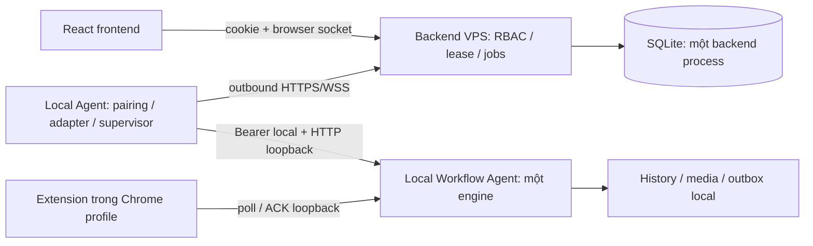

# Kế hoạch tích hợp Local Workflow Agent

Ngày khảo sát: 2026-11-11. Đây là phân tích source và bộ prompt chuẩn bị triển khai;
chưa tích hợp runtime, chưa khởi động Chrome/engine, chưa deploy VPS.

## Kết luận kiến trúc

Giữ backend/frontend và pairing/lease Socket.IO của source chính làm đường điều
khiển từ xa cho chế độ tích hợp. `local-agent/` giữ credential thiết bị, kết nối
outbound tới VPS và quản lý adapter/supervisor. Local Workflow Agent là tiến trình
engine riêng trên cùng máy, gọi qua HTTP loopback. Extension tiếp tục chạy trong
từng Chrome profile và lấy bước từ engine. Không nhúng Chrome/video vào VPS.

Tái sử dụng policy, journal/outbox, metadata và nguyên tắc chống replay của
control-server; port theo mô hình dữ liệu/quyền của core. Không chạy thêm
control-server như một backend điều khiển thứ hai trong chế độ tích hợp.

Đường gọi được relay hai chiều trên kết nối outbound có sẵn. FE không gọi trực
tiếp cổng local. Quyền điều khiển phải được kiểm tra ở VPS và local; local vẫn
được dùng dashboard của engine như một quyền quản trị tại máy, ngoài lease web.
Không tuyên bố độc quyền toàn bộ desktop hay ngăn được phần mềm cùng tài khoản OS.

## Bằng chứng từ source

| Thành phần | File đã đọc | Đã có | Phần còn thiếu cho mục tiêu tích hợp |
| --- | --- | --- | --- |
| Relay VPS | `backend/src/workflow.js`, `backend/src/server.js` | `workflow:request`, capability, RBAC, active lease đúng browser, kiểm tra lại sau ACK, giới hạn request/response | Capability hiện dựa trên cấu hình; chưa có health/version runtime của engine, local policy riêng cho bridge, jobs bền vững |
| Adapter local | `local-agent/src/workflow.js`, `local-agent/src/index.js` | 7 operation cố định, HTTP `127.0.0.1`, token local, Idempotency-Key, abort khi lease hết/revoke/disconnect | Chưa supervisor engine/Chrome; abort fetch không phải stop workflow đã nhận; chưa journal bền vững cho bridge |
| Panel web | `frontend/src/WorkflowPanel.jsx`, `frontend/src/main.jsx` | Chọn profile/scenario, biến JSON, run/status/history/stop, poll 2 giây, requestId cho retry | Chưa có mở profile qua bridge, health engine độc lập, đồng bộ job bền vững và UX trạng thái chưa rõ kết quả |
| Engine | `ref/local_workflow_agent-dev-remote/local-workflow-agent/src/main.js`, `src/http/automation-api.js` | API v1 có token, dashboard, scenario đã lưu, HTTP loopback, daemon và port guard | API v1 chưa có health/profile-open/lease grant; `/api/profiles/open` là API dashboard cũ, không tự coi là endpoint bridge mới |
| Engine execution | `local-workflow-agent/src/workflow/workflows.js`, `src/workflow/variables.js` trong ref | Một run/profile, kiểm tra extension cho bước web, ACK theo bước, stop/timeout, history và media guard | Cần ràng buộc run từ xa với grant/lease và local policy; kiểm tra biến có thể thay URL/path/action nhạy cảm |
| Remote tham chiếu | `local-workflow-agent/src/integrations/remote/remote-client.js`, `remote-executor.js` trong ref | Poll 3 giây, local allowlist profile/scenario/biến, journal trước execute, report seq/ACK, không replay khi crash mơ hồ | Credential, pairing và giao thức riêng; không thể copy thẳng vào Socket.IO rồi coi là cùng lease |
| Server tham chiếu | `control-server/src/server.js`, `commands.js`, `store.js` trong ref | Auth, pairing local approval, owner-based commands, TTL, dispatch/reports, SQLite records | Không có quan hệ members và browser lease như core; instance lease 35 giây chỉ chống hai agent, không phải quyền điều khiển của user |
| Extension | `chrome-reels-extension/manifest.json`, `background.js`, `options.js`, `content.js` trong ref | MV3 4.2.2, profile/clientId trong storage, poll `/next`, trả `/result`, `/state`, discovery `/api/profiles` | URL cố định `127.0.0.1:34719`; cài/enable extension và chọn profile là bước riêng; không có bảo đảm tự cài extension khi launch Chrome |
| Packaging | `local-workflow-agent/package.json`, `src/paths.js`, package gốc của hai repo | Engine CommonJS, core ESM/workspaces; engine standalone có dependency MongoDB, fallback layout legacy | Cần ranh giới package, provenance, lockfile/test ownership và migration rõ ràng; không copy dữ liệu runtime từ ref |

Đường dẫn không có tiền tố đầy đủ trong bảng được hiểu tương đối với ba app trong
`ref/local_workflow_agent-dev-remote/`. Đọc lại source trước từng bước vì workspace
đang có thay đổi chưa commit, gồm workflow bridge; tài liệu starter không phản ánh
hết phần đã triển khai.

## Hợp đồng hiện có cần giữ

- Operation bridge: `profiles`, `scenarios`, `describe`, `runs`, `status`, `run`,
  `stop`. API đích là `/api/v1/profiles`, `/scenarios`, `/scenarios/:name`,
  `/runs`, `/runs/:runId`, `/runs/:runId/stop` với method như `docs/WORKFLOW.md`.
- Frontend chỉ gửi ID scenario/profile đã được cấp, biến hợp lệ, runId/requestId;
  không gửi shell, steps, executable, URL API hay uploadPath. CLI local có quyền
  khác, không mở rộng quyền web theo CLI.
- Bridge hiện giới hạn params 12.000 byte, response khoảng 512.000 byte, tối đa
  4 request chờ, timeout VPS 12 giây; client local timeout 10 giây. Cần giữ giới
  hạn nhất quán hoặc version hóa khi thay đổi.
- Idempotency API v1 hiện chỉ ở RAM, tối đa 200 khóa, mất khi restart. History
  local tồn tại không đồng nghĩa khóa chống chạy trùng tồn tại. HTTP 202 chỉ là
  đã nhận, không phải thành công. Không hứa exactly-once cho upload website.
- Core đang cho workflow đã nhận tiếp tục khi mất lease. Chuyển sang dừng run từ
  xa là thay đổi hành vi, phải có grant/watchdog tại engine và test, không chỉ
  thêm AbortController ở adapter.
- Remote Terminal hiện có vẫn là luồng riêng. Bộ prompt này không phục hồi generic
  script runner đã bị gỡ và không dùng terminal làm kênh khởi động engine.

## Các quyết định cho chế độ tích hợp

1. Dùng một identity thiết bị/pairing core. Engine vẫn hỗ trợ standalone nhưng
   integrated mode vô hiệu hóa đường nhận lệnh HTTP control-server cũ. Không xóa
   remote.json hay credential cũ; nếu phát hiện cấu hình cũ thì yêu cầu xử lý
   rõ ràng tại local, không âm thầm chạy cả hai.
2. Package engine tại `local-agent/workflow-engine/`, extension tại
   `local-agent/chrome-reels-extension/` là layout đích đề xuất. Chốt ở WFI-01 sau
   khi kiểm tra dependency/lockfile; `ref/` chỉ làm nguồn tham chiếu. Giữ engine
   process riêng, CommonJS package riêng, entrypoint standalone tương thích.
3. Có chế độ attach engine đã chạy và managed engine do runner khởi động. Attach
   không được tự kill engine ngoài quyền sở hữu; managed mới quản lý process con.
   Không tự move scenarios/data hoặc sinh lại machine ID trên installation cũ.
4. Default integrated mode dừng run từ xa thuộc grant cũ khi revoke/expiry/offline;
   engine tự hết quyền nếu mất adapter. Run local độc lập không bị dừng theo lease
   web. Chờ xác nhận hết run cũ trước khi takeover được quyền chạy mới; chưa chứng
   minh dừng thì giữ `stopping/unknown` và chặn lệnh có side effect.
5. Local policy deny-by-default theo profile/scenario/biến; validate giá trị theo
   từng scenario, không chỉ kiểu primitive. Biến URL/path phải có domain/root
   local được phép hoặc không cho override từ xa. Local duyệt policy, FE không
   tự tăng quyền. Owner/operator vẫn phải có active lease và policy cho phép.
6. Một run/profile như engine hiện có. File picker/GUI tác động cửa sổ foreground
   cần kiểm tra và khóa tài nguyên toàn máy khi cần; test trước khi cho chạy các
   profile đồng thời. Terminal và người dùng local vẫn có thể tác động Chrome.
7. Giữ cổng 34719 cho extension giai đoạn đầu; không quảng bá port tùy ý khi
   options/background còn hardcode. Không bật remote debugging port công khai.
8. Đồng bộ metadata/trạng thái/job qua VPS; video, cookies, Chrome user data,
   token và file cục bộ ở local. MongoDB/outbox của engine là hệ riêng, không thay
   DB users/members/lease của core. Chưa có yêu cầu đồng bộ sửa scenario/media hai chiều.

## Thứ tự prompt và điểm dừng

Đọc [quy tắc chạy chung](prompts/planned/workflow-integration/README.md) rồi thực
hiện đúng một prompt mỗi lượt. WFI là dãy riêng, không thay thế số 001–008 cũ.

| Bước | Prompt | Kết quả cần có trước bước tiếp |
| --- | --- | --- |
| WFI-01 | [Chốt contract và layout](prompts/planned/workflow-integration/01-contract-layout.md) | ADR, inventory, policy/lifecycle/version contract, kế hoạch package/test |
| WFI-02 | [Đóng gói engine và extension](prompts/planned/workflow-integration/02-package-engine.md) | Source runnable độc lập, giữ behavior, test engine được nối CI |
| WFI-03 | [Policy và grant tại engine](prompts/planned/workflow-integration/03-engine-policy-grants.md) | Đường điều khiển duy nhất cho integrated mode, watchdog và stop có bằng chứng |
| WFI-04 | [Supervisor và health local](prompts/planned/workflow-integration/04-local-supervisor.md) | Attach/managed an toàn, không double engine, health/version chính xác |
| WFI-05 | [Chrome profile và extension](prompts/planned/workflow-integration/05-chrome-extension.md) | Mở profile allowlist, trạng thái extension thật, hướng dẫn cài/enable |
| WFI-06 | [Jobs, journal và đồng bộ VPS](prompts/planned/workflow-integration/06-jobs-sync.md) | Idempotency bền vững, reports không lùi, reconcile không replay |
| WFI-07 | [Frontend tích hợp](prompts/planned/workflow-integration/07-frontend.md) | UX health/open/run/stop/history theo đúng quyền và trạng thái |
| WFI-08 | [Nghiệm thu và vận hành](prompts/planned/workflow-integration/08-validation-operations.md) | E2E profile riêng, tài liệu cài/rollback, ma trận phần đã/chưa kiểm tra |

WFI-01 đến WFI-05 tạo nền chạy an toàn; WFI-06 giải quyết khôi phục và đồng bộ
bền vững trước khi gọi tích hợp hoàn chỉnh. Có thể chạy fixture UI trong lúc
phát triển nhưng nghiệm thu cuối phải dùng engine và extension thật ở profile test.
Mỗi bước cập nhật docs/API, PROGRESS, env examples và test nếu thay behavior.
Không chuyển prompt sang completed nếu còn acceptance chưa đạt.

## Kiểm chứng trong lần khảo sát

Đã chạy `npm test` và `npm run build` ở repo chính; kết quả cuối được ghi tại
`docs/PROGRESS.md`. Chưa chạy suite repo tham chiếu, chưa thử MongoDB/yt-dlp,
extension thật, Scheduled Task, VPS hay mạng WAN. Kế hoạch dựa trên source và
docs tại workspace, không phải cam kết tương thích môi trường triển khai.
